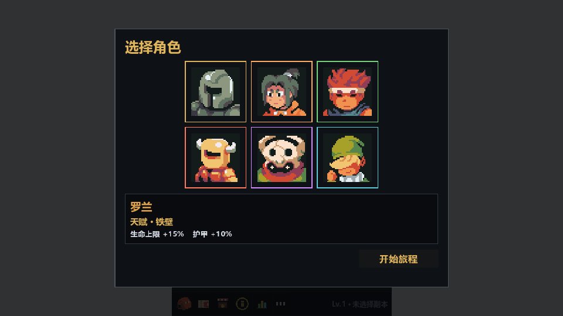
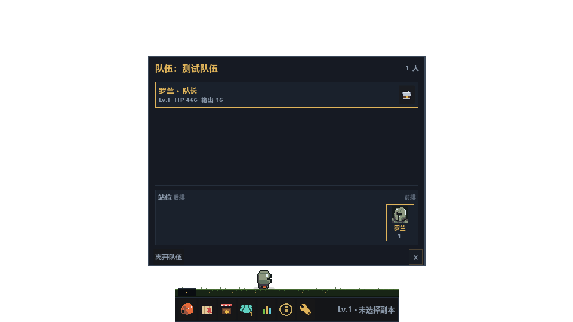
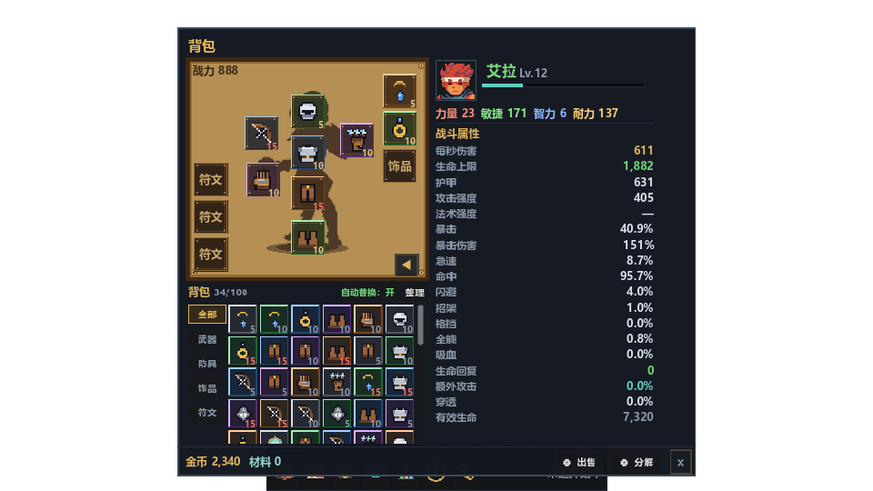

# KeepForward

桌面宠物式像素挂机小游戏。没有技能和手动战斗，只有角色天赋、装备词条、套装和一路变强的数字。

- 版本：0.97.0
- 平台：Windows
- 引擎：Godot 4.7.2

> 截图白色区域为透明区域，实际运行会透出桌面。

## 运行

双击 `build/KeepForward.exe`，或双击根目录 `run.bat`。

没有存档时进入角色选择，已有存档直接进入游戏。

## 玩法

- 六名角色、三种职业、六条战斗流派
- 选择角色后自动挂机刷副本，击败怪物、拾取装备、升级变强
- 副本分普通、精英、英雄，另有区域首领
- 局域网组队，最多不限人数，队友一起自动战斗
- 自动连续副本，可重复当前副本或自动下一层

## 特色

- **桌面宠物**：无边框透明窗口，可直接嵌在桌面上
- **点击穿透**：透明区域不挡鼠标，可以正常操作下方软件
- **没有操作压力**：角色自动战斗，适合放在屏幕角落挂机
- **装备构筑**：品质、词条、穿戴等级、套装效果共同决定强度
- **流派差异**：武器决定战斗被动，防具决定属性倾向
- **套装收集**：三职业共 30 套、90 件具名套装
- **组队成长**：队友各自结算奖励，前排承伤、后排输出
- **轻量存档**：升级和通关自动保存，并保留上一份存档备份

## 功能

- 角色选择与角色天赋
- 自动战斗、自动副本、自动下一层
- 背包、装备拖拽、锁定、出售、分解、一键出售、一键分解
- 装备品质、随机词条、穿戴等级、套装效果
- 背包悬浮装备时与对应穿戴装备并排对比
- 出售/分解支持自动开关与按品质筛选
- 商店刷新与价格浮动
- 副本地图、难度选择、区域探索和首领
- 副本悬浮显示推荐战力，底部显示当前/队伍等级与战力
- 局域网组队、房间密码、手动 IP 加入
- 队伍站位调整、队友装备查看
- 信息窗口、属性看板、设置
- 信息窗口支持「战斗」与「综合」两个分类
- 透明点击穿透、窗口拖动、底部栏收起

## 详细说明

角色天赋表、装备公式、套装清单、战斗数值、掉落权重、存档路径和测试命令等细节，统一放在 [DETAILS.md](DETAILS.md)。
